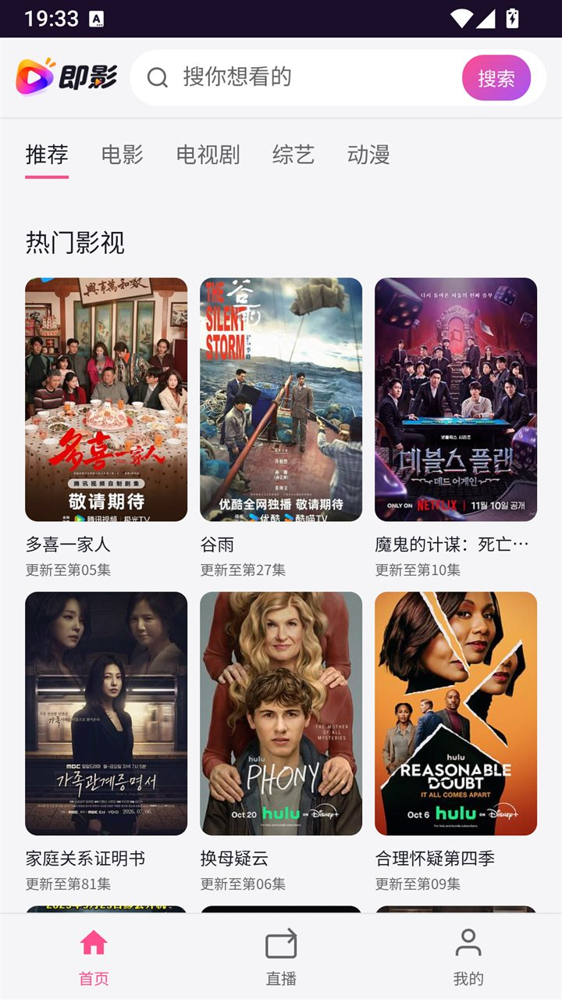
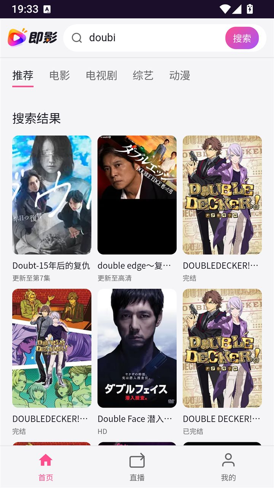
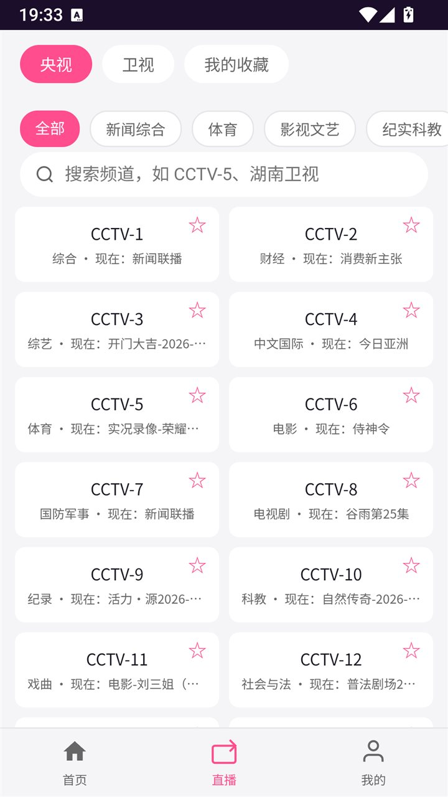
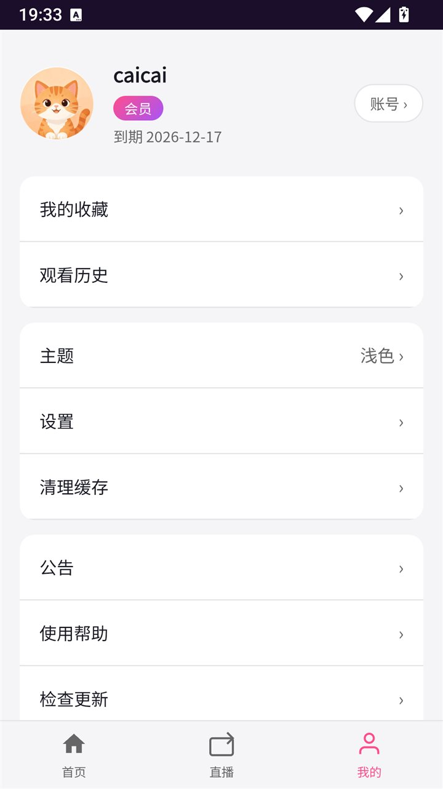
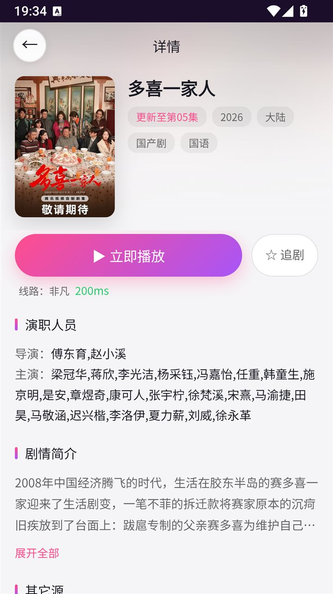
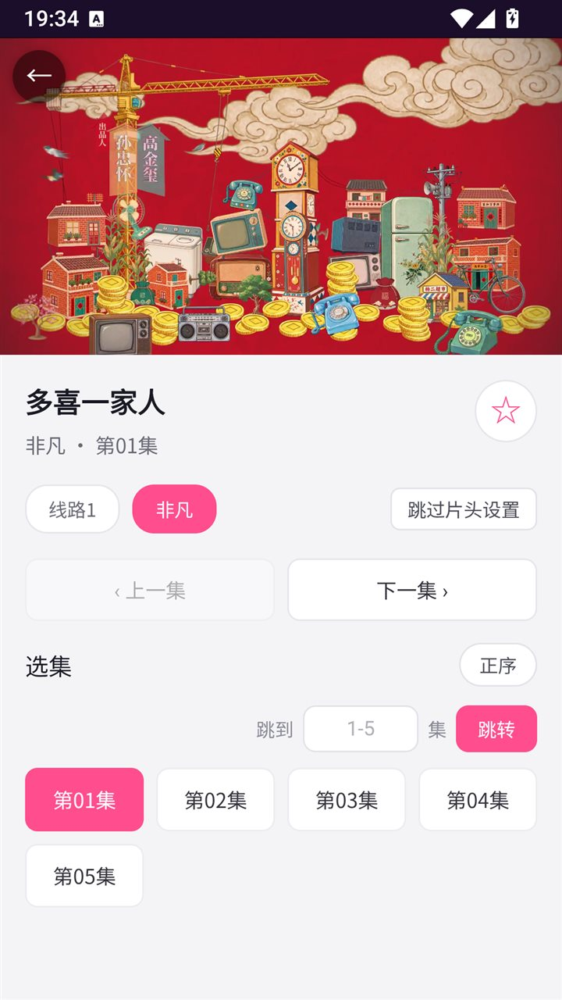

# 即影 · 安装包发布

这是「即影」Android 客户端的**公开下载页**，只放安装包与更新说明。源码在私有仓库，不在这里。

## 截图

均为 Android 模拟器（1080×1920）实机截图，连接的是线上账号服务。

| 首页 · 分类推荐 | 多源聚合搜索 | 电视直播 |
|------|------|------|
|  |  |  |

| 我的 · 会员与设置 | 影视详情（多线路测速） | 播放页（线路切换 / 选集） |
|------|------|------|
|  |  |  |

## 下载

| 版本 | 说明 | 安装包 |
|---|---|---|
| v2.0.1 | 当前版本：多源聚合搜索、央视卫视直播、账号注册/登录、会员到期提醒 | [shijie-2.0.1.apk](apk/shijie-2.0.1.apk)（4.11 MB） |

也可以到 **Releases** 页面下载，方便固定链接分享。

## 安装

1. 手机上下载上面的 `.apk`；
2. 首次安装需要在系统设置里允许「安装未知来源应用」；
3. 打开即影 → 「注册」页填入管理员发放的注册码 → 完成注册即可使用。

> 一个注册码只能用一次，绑定首次登录的设备。换手机请联系管理员解绑。

## 系统要求

- Android 7.0（API 24）及以上
- 需要联网；直播与点播均走 HLS，建议 Wi-Fi 或稳定 4G/5G

## 签名与升级

- 安装包使用固定正式签名（`release.keystore`），可直接覆盖升级，本地收藏/历史保留。
- 若你之前装过用其它签名打的包，需要先卸载再安装（不同签名不能覆盖）。

## 注意

App 内的影视、直播内容来自第三方公开接口，本项目只提供客户端与账号体系，不存储任何影视文件。请自行确认使用场景与当地法规，建议仅作个人学习与测试用途。
